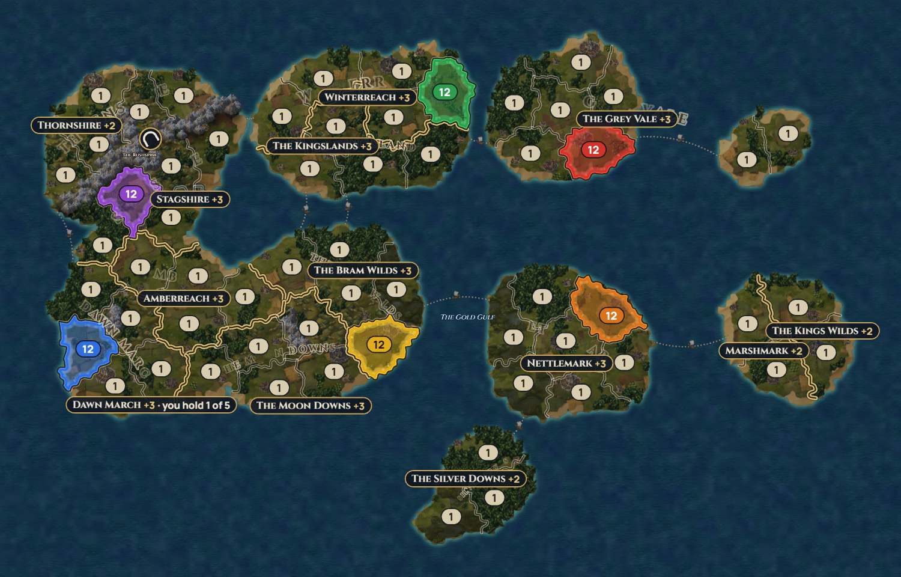
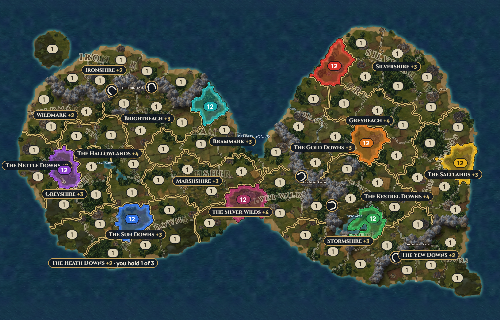
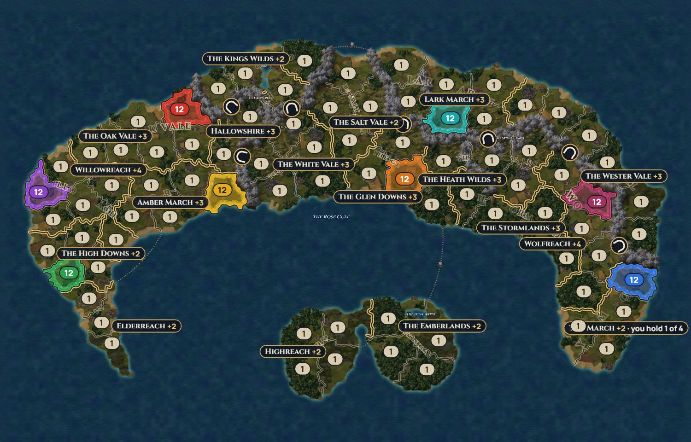
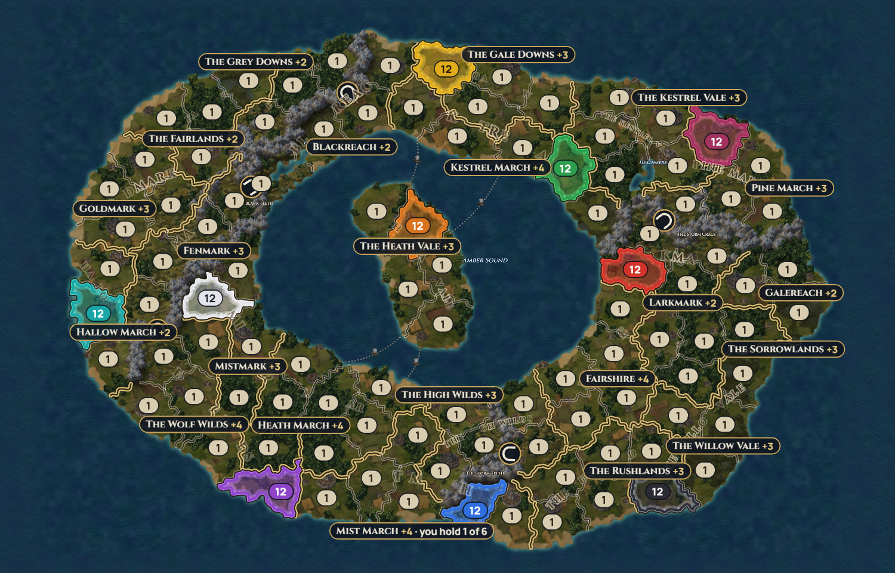
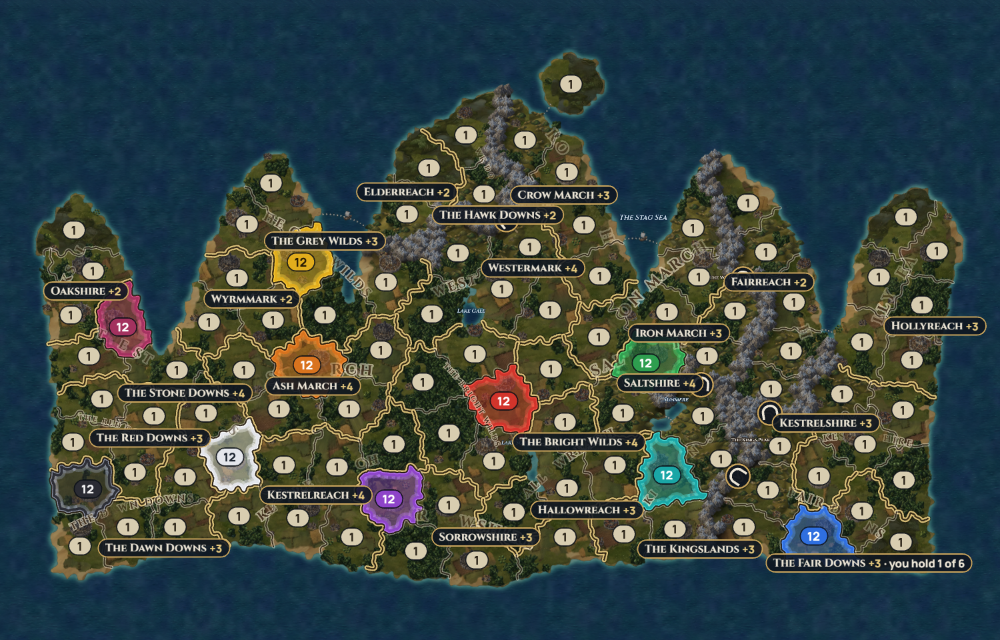
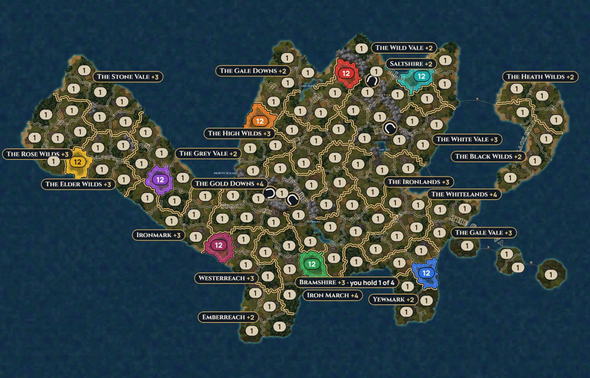

# Candidate maps (session 10)

**Nate's pick (Oct 5): all six become official in session 11.** Wyrmland is rebuilt from a Gemini dragon outline and suggested for 6–10 players.

**Session 11 (Oct 5): all six are official** (in `packages/mapgen/src/configs.ts` with exactly these recipes, and in the lobby). Art batch 3 hadn't been made yet, so there was no Gemini dragon outline: **Wyrmland keeps today's hand-drawn dragon and seed (`mask-120-2`)** for now, with suggested players 6–10. It gets rebuilt from `mask-dragon.png` once that arrives (see "Wyrmland: session 11 sims" below).

*Six new maps for Nate to choose from, made with the new land shapes. None is in the lobby yet: Nate picks which become official (then follow "How to make a seed an official map" in `docs/07-map-tooling.md`).*

**How they were picked:** for each recipe I made six seeds in the map lab's way (`pnpm try-maps`), looked at them side by side, and took the one that looks most like a real place. Each one then got 200 all-Captain games (fog on, normal luck, Classic) at the two ends of its suggested player range, next to 200 games on a plain one-continent map of the same size, to see what the shape itself does. The numbers are in `docs/maps/candidates.json`; `pnpm --filter @conquerra/sim candidates` makes them again.

**Target:** games may run up to 30–40 turns (Nate, Oct 5). "Within 40" is the share of games that finished in 40 turns or fewer.

**To look at one in the lab:** open `conquerra.overconfidenceonline.com/?lab=maps`, press **Paste recipe** and paste the recipe under the map (or choose its shape, size and seed: all but Wyrmland use the lab's default settings for that shape and size).

## In one line each
| Map | Shape, size | Suggested players | Average turns (low end / high end of the range) | Why this one |
|---|---|---|---|---|
| **The Shattered Isles** | archipelago, 60 | 4–6 | 28.2 / 36.9 | Nine islands of different sizes and an islet; every crossing is a sea lane, so fleets matter. |
| **The Twin Realms** | twin continents, 80 | 4–8 | 24.4 / 29.8 | Two continents joined by one narrow land bridge and two sea lanes: a natural front line. |
| **The Moon Coast** | crescent, 80 | 4–8 | 27.0 / 31.2 | A long crescent round a bay with two isles in it: short fronts, long marches, lots of comebacks. |
| **The Ringsea** | inland sea, 100 | 6–10 | 35.9 / 38.6 | Land in a ring round an inland sea, with an island in the middle every shore can reach. |
| **The Crownlands** | silhouette (crown), 100 | 6–10 | 35.0 / 38.4 | My extra: a crown with five peninsula points, each a natural stronghold. |
| **Wyrmland** | silhouette (dragon), 120 | 6–8 | 31.9 / 36.5 | The biggest: a dragon (head, neck, wing, legs, and its tail curled into an island). |

All six pass every check: connected, territories 67–123% of average size, provinces of 2–8 territories each in one piece, fair capitals for every player count from 2 up, no hairline borders, wide passes, and enough sea lanes and choke points.

## The Shattered Isles: archipelago, 60 territories


13 provinces, players 2–6 (suggested 4–6). 9 sea lanes, 1 pass. Territory sizes 83–113% of average. Capitals: 3–14 borders apart, nearby gold within 71–100%. Made on the first try (0.5 s).

| Players | Average turns (median) | Within 40 / in 30–40 | Seat wins | Half the map by turn 10 | Halfway leader wins | Comebacks | Battles across passes / sea lanes |
|---|---|---|---|---|---|---|---|
| 4 | **28.2** (25) | 89% / 22% | 20%–31% | 24% | 77% | 37% | 1% / 8% |
| 4, plain continent | 27.2 (26) | 90% / 19% | 23%–28% | 8% | 85% | 31% | 3% / 2% |
| 6 | **36.9** (35) | 70% / 41% | 13%–23% | 15% | 82% | 41% | 1% / 7% |
| 6, plain continent | 25.2 (24) | 96% / 19% | 12%–21% | 20% | 86% | 21% | 2% / 2% |

<details><summary>Recipe</summary>

```json
{"id":"shattered-isles","name":"The Shattered Isles","seed":"archipelago-60-5","shape":"archipelago","territories":60,"provinces":13,"players":{"min":2,"max":6,"recommended":{"min":4,"max":6}},"seas":0,"lakes":0,"islandChains":0,"islands":9,"mountainRanges":1,"seaLanes":5,"minSeaLanes":8,"rivers":3,"minChokePoints":5,"roughness":0.6}
```
</details>

## The Twin Realms: twin continents, 80 territories


18 provinces, players 2–8 (suggested 4–8). One land bridge, 2 sea lanes, 5 passes. Sizes 77–117%. Capitals 3–13 borders apart, nearby gold within 73–90%. Made on try 2 (2.9 s).

| Players | Average turns (median) | Within 40 / in 30–40 | Seat wins | Half the map by turn 10 | Halfway leader wins | Comebacks | Battles across passes / sea lanes |
|---|---|---|---|---|---|---|---|
| 4 | **24.4** (24) | 98% / 12% | 23%–27% | 7% | 88% | 23% | 2% / 0% |
| 4, plain continent | 33.8 (32) | 77% / 36% | 21%–28% | 2% | 81% | 38% | 2% / 1% |
| 8 | **29.8** (28) | 92% / 33% | 7%–15% | 1% | 82% | 36% | 2% / 0% |
| 8, plain continent | 32.9 (30) | 77% / 28% | 9%–17% | 6% | 87% | 25% | 3% / 2% |

<details><summary>Recipe</summary>

```json
{"id":"twin-realms","name":"The Twin Realms","seed":"twinContinents-80-2","shape":"twinContinents","territories":80,"provinces":18,"players":{"min":2,"max":8,"recommended":{"min":4,"max":8}},"seas":0,"lakes":2,"islandChains":1,"mountainRanges":3,"seaLanes":3,"minSeaLanes":2,"rivers":4,"minChokePoints":7,"roughness":0.6}
```
</details>

## The Moon Coast: crescent, 80 territories


18 provinces, players 2–8 (suggested 4–8). 4 sea lanes, 7 passes, 1 land bridge. Sizes 67–120%. Capitals 3–16 borders apart, nearby gold within 75–83%. Made on try 8 (12 s; crescents need the most tries).

| Players | Average turns (median) | Within 40 / in 30–40 | Seat wins | Half the map by turn 10 | Halfway leader wins | Comebacks | Battles across passes / sea lanes |
|---|---|---|---|---|---|---|---|
| 4 | **27.0** (25) | 94% / 20% | 20%–29% | 12% | 86% | 20% | 6% / 2% |
| 4, plain continent | 33.8 (32) | 77% / 36% | 21%–28% | 2% | 81% | 38% | 2% / 1% |
| 8 | **31.2** (30) | 88% / 38% | 9%–17% | 0% | 64% | 53% | 4% / 2% |
| 8, plain continent | 32.9 (30) | 77% / 28% | 9%–17% | 6% | 87% | 25% | 3% / 2% |

<details><summary>Recipe</summary>

```json
{"id":"moon-coast","name":"The Moon Coast","seed":"crescent-80-2","shape":"crescent","territories":80,"provinces":18,"players":{"min":2,"max":8,"recommended":{"min":4,"max":8}},"seas":0,"lakes":2,"islandChains":0,"mountainRanges":3,"seaLanes":3,"minSeaLanes":2,"rivers":4,"minChokePoints":7,"roughness":0.6,"laneReach":20}
```
</details>

## The Ringsea: inland sea, 100 territories


22 provinces, players 2–10 (suggested 6–10). 4 sea lanes (to the middle island), 5 passes. Sizes 75–115%. Capitals 3–15 borders apart, nearby gold within 71–100%. Made on the first try (3.1 s).

| Players | Average turns (median) | Within 40 / in 30–40 | Seat wins | Half the map by turn 10 | Halfway leader wins | Comebacks | Battles across passes / sea lanes |
|---|---|---|---|---|---|---|---|
| 6 | **35.9** (35) | 74% / 50% | 11%–23% | 1% | 77% | 42% | 2% / 3% |
| 6, plain continent | 37.2 (35) | 70% / 42% | 15%–21% | 0% | 74% | 49% | 3% / 2% |
| 10 | **38.6** (37) | 63% / 48% | 6%–14% | 0% | 79% | 44% | 2% / 2% |
| 10, plain continent | 42.3 (41) | 48% / 40% | 6%–14% | 0% | 75% | 60% | 4% / 1% |

<details><summary>Recipe</summary>

```json
{"id":"ringsea","name":"The Ringsea","seed":"inlandSea-100-6","shape":"inlandSea","territories":100,"provinces":22,"players":{"min":2,"max":10,"recommended":{"min":6,"max":10}},"seas":0,"lakes":3,"islandChains":0,"mountainRanges":3,"seaLanes":4,"minSeaLanes":2,"rivers":5,"minChokePoints":8,"roughness":0.6,"laneReach":20}
```
</details>

## The Crownlands: crown silhouette, 100 territories


22 provinces, players 2–10 (suggested 6–10). 5 sea lanes, 5 passes. Sizes 72–116%. Capitals 2–16 borders apart, nearby gold within 70–100%. Made on the first try (2.9 s).

| Players | Average turns (median) | Within 40 / in 30–40 | Seat wins | Half the map by turn 10 | Halfway leader wins | Comebacks | Battles across passes / sea lanes |
|---|---|---|---|---|---|---|---|
| 6 | **35.0** (34) | 80% / 56% | 14%–21% | 1% | 76% | 52% | 3% / 2% |
| 6, plain continent | 37.2 (35) | 70% / 42% | 15%–21% | 0% | 74% | 49% | 3% / 2% |
| 10 | **38.4** (36) | 66% / 49% | 7%–19% | 0% | 87% | 51% | 2% / 1% |
| 10, plain continent | 42.3 (41) | 48% / 40% | 6%–14% | 0% | 75% | 60% | 4% / 1% |

<details><summary>Recipe</summary>

```json
{"id":"crownlands","name":"The Crownlands","seed":"mask-100-5","shape":"mask","mask":"crown","territories":100,"provinces":22,"players":{"min":2,"max":10,"recommended":{"min":6,"max":10}},"seas":0,"lakes":3,"islandChains":1,"mountainRanges":3,"seaLanes":4,"minSeaLanes":2,"rivers":5,"minChokePoints":8,"roughness":0.38}
```
</details>

## Wyrmland: dragon silhouette, 120 territories


27 provinces, players 2–10 (suggested 6–8). 6 sea lanes, 4 passes. Sizes 77–123%. Fair capitals for every count up to 10. Made on the first try (1.4 s).

**Changed from the default recipe:** 2 mountain ranges instead of 4. With 4 (11 passes) games ran too long: 44.0 turns at 8 players and 45.3 at 10. With 2 it's 36.5 at 8, but 10 players still averages about 41.5 turns (100 games), so it's suggested for 6–8.

| Players | Average turns (median) | Within 40 / in 30–40 | Seat wins | Half the map by turn 10 | Halfway leader wins | Comebacks | Battles across passes / sea lanes |
|---|---|---|---|---|---|---|---|
| 6 | **31.9** (30) | 87% / 40% | 13%–20% | 1% | 89% | 32% | 1% / 1% |
| 6, plain continent | 37.8 (36) | 69% / 52% | 14%–22% | 0% | 82% | 53% | 5% / 1% |
| 8 | **36.5** (35) | 76% / 59% | 9%–18% | 0% | 82% | 47% | 1% / 1% |
| 8, plain continent | 39.6 (37) | 64% / 53% | 9%–17% | 0% | 83% | 38% | 5% / 1% |

<details><summary>Recipe</summary>

```json
{"id":"wyrmland","name":"Wyrmland","seed":"mask-120-2","shape":"mask","mask":"dragon","territories":120,"provinces":27,"players":{"min":2,"max":10,"recommended":{"min":6,"max":8}},"seas":0,"lakes":3,"islandChains":1,"mountainRanges":2,"seaLanes":5,"minSeaLanes":2,"rivers":6,"minChokePoints":10,"roughness":0.38}
```
</details>

### Wyrmland: session 11 sims (200 Captain games each, fog on, normal luck, Classic, seeds `wyrm`)
| Players | Average turns (median) | Within 40 / in 30–40 | Seat wins | Halfway leader wins | Comebacks | Hit the 60-turn cap |
|---|---|---|---|---|---|---|
| 6 | **32.9** (32) | 84% / 44% | 14%–20% | 84% | 36% | 0.5% |
| 8 | **36.9** (35) | 75% / 58% | 9%–14% | 86% | 48% | 2.5% |
| 10 | **39.7** (38) | 61% / 52% | 7%–14% | 81% | 54% | 6% |

At 10 players a Wyrmland game averages just under 40 turns (Nate allows 120-territory maps for 10 players).

## Also shown (not candidates)
A plain 80-territory continent and a shield silhouette, so there's one Far view of every shape: `docs/art/screens/shape-continent.png`, `shape-shield.png`.

## What the shape does to game length and runaways (for the balance pass)
- **Mountain passes are the biggest lever on length.** Wyrmland went from 44–45 turns to 32–37 just by having 4 passes instead of 11. On every map, few battles happen at passes (1–6%), but armies queue up behind them.
- **Two halves or a long thin land end sooner:** the Twin Realms are 9 turns shorter than a plain continent at 4 players (24.4 vs 33.8), and the Moon Coast 7 shorter (27.0 vs 33.8). The difference shrinks at 8 players (about 2–3 turns).
- **Islands make bigger tables slower:** the Shattered Isles play like a continent at 4 players (28 vs 27 turns) but 12 turns longer at 6 (36.9 vs 25.2), because every attack between islands crosses a sea lane at ×0.75. That's also where most sea battles happen (7–8% of battles, against 1–2% elsewhere).
- **Size sets the 10-player length:** at 10 players, the 100-territory maps run 38–39 turns (inside the target); 120-territory maps run 41.5–45; Greatmarch (80) runs about 35. So 10-player games fit best on about 100 territories.
- **Runaways:** shape matters less than table size. Early runaways (half the map by turn 10) are rare on every new map at 6+ players (0–1%) and highest on the archipelago at 4 players (24%: whoever owns the biggest island early snowballs). The crescent gives the most comebacks at 8 players (53%, and the halfway leader wins only 64% of games, the least predictable of all).
- **Seats stay fair** on every candidate within the noise of 200 games.
